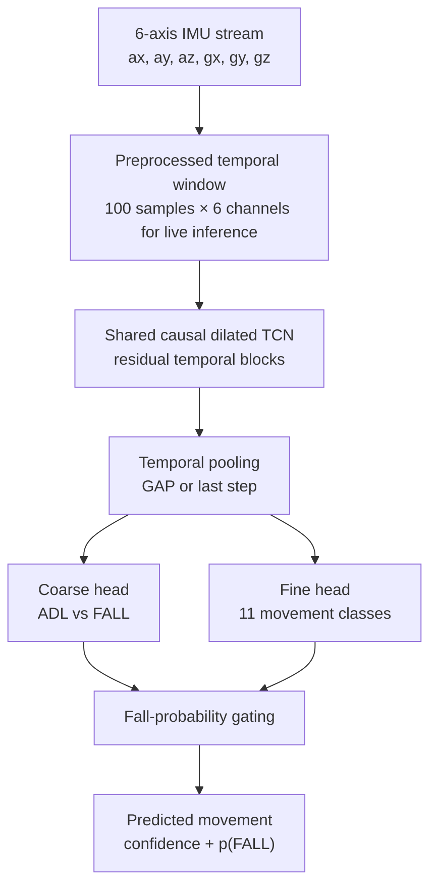

# Safeguard — Real-Time Fall Detection & Activity Recognition

**Hierarchical Temporal Convolutional Network (TCN) for IMU-based fall detection and recognition of 11 movement classes.**

[](https://www.python.org/)
[](https://pytorch.org/)


Safeguard processes accelerometer and gyroscope measurements from a wearable inertial measurement unit (IMU) to answer two questions simultaneously:

1. **Coarse classification:** Is the movement an **activity of daily living (ADL)** or a **fall**?
2. **Fine classification:** Which of **11 specific movements** best describes the signal?

The model uses a **shared causal, dilated 1D TCN backbone** with two classification heads. The repository provides **offline inference on saved sensor windows** and **live inference from a serial-connected IMU stream**, including a configurable fall-probability decision gate.

> **Project context:** This model was developed as the machine-learning component of the **Safeguard smart-helmet concept**. The research data used here come from **chest-mounted sensors in UMAFall**; performance on a helmet-mounted sensor must be validated separately because sensor placement changes the signal distribution.

## Contents

- [Highlights](#highlights)
- [How it works](#how-it-works)
- [Movement classes](#movement-classes)
- [Repository structure](#repository-structure)
- [Getting started](#getting-started)
- [Offline inference](#offline-inference)
- [Real-time serial inference](#real-time-serial-inference)
- [Training and checkpoints](#training-and-checkpoints)
- [Reported experimental results](#reported-experimental-results)
- [Limitations and next steps](#limitations-and-next-steps)
- [Dataset and references](#dataset-and-references)

## Highlights

- **Dual-task learning:** Two heads share temporal features while predicting both fall/ADL status and the detailed movement class.
- **Causal temporal modeling:** Left-padded, dilated 1D convolutions use the current and preceding samples rather than future samples.
- **Residual TCN blocks:** Two convolutional layers per block with batch normalization, GELU activation, dropout, and a residual connection.
- **Configurable temporal pooling:** Global average pooling (`gap`) or the final temporal feature (`last`).
- **Decision gating:** A threshold on `p(FALL)` constrains the final fine-class prediction to either the ADL or fall classes.
- **Multi-window aggregation:** Mean logits, mean probabilities, or majority voting for saved window sequences.
- **Streaming support:** Rolling 100-sample windows with an adjustable inference stride over a JSON-over-serial IMU feed.
- **CPU / CUDA support:** PyTorch inference with selectable compute device.

## How it works



### Model architecture

The implementation in [`infer_tcn_hier.py`](./infer_tcn_hier.py) defines the TCN and both heads.

| Component | Implementation |
| --- | --- |
| Input | Six channels: `ax`, `ay`, `az`, `gx`, `gy`, `gz` |
| Backbone | Stack of causal, dilated `Conv1d` residual blocks |
| Channel widths | Configurable; example: `64, 64, 96, 96` |
| Dilation schedule | `1, 2, 4, 8` for four blocks |
| Convolution kernel | Configurable; example: `5` |
| Nonlinearity / regularization | GELU, batch normalization, dropout |
| Temporal pooling | `gap` or `last` |
| Coarse head | Linear layer with 2 output logits |
| Fine head | Linear layer with 11 output logits |

Each TCN block contains **two** dilated temporal convolutions. For four blocks, kernel size 5, and dilations `[1, 2, 4, 8]`, the theoretical receptive field is **121 samples**. This covers an entire 100-sample live window without requiring future sensor readings.

### Hierarchical prediction and fall gate

For a sensor window $X$, the network computes shared features $h=f_{\mathrm{TCN}}(X)$, then predicts:

$$
p_{\mathrm{coarse}}=\mathrm{softmax}(W_c h+b_c),\qquad
p_{\mathrm{fine}}=\mathrm{softmax}(W_f h+b_f).
$$

The coarse head estimates `p(FALL)`. With the gate enabled at threshold $\tau$:

- If `p(FALL) >= τ`, the final fine prediction is restricted to the **three fall classes**.
- Otherwise, it is restricted to the **eight ADL classes**.
- For offline inference, `--gate_thr -1` disables the gate and allows all 11 classes.

**Important:** Gating changes the *final decision*, not the neural network weights. Threshold choice affects the false-alarm / missed-fall trade-off and should be selected using validation data.

### Training objective

The hierarchical training setup described for this project combines two classification losses:

$$
\mathcal{L}_{\mathrm{total}}=\mathcal{L}_{\mathrm{fine}}+\alpha\,\mathcal{L}_{\mathrm{coarse}}
$$

where $\alpha$ is controlled by `--coarse_loss_weight` in the training configuration. The shared representation is optimized to capture both broad fall-related patterns and subtle differences among daily activities.

## Movement classes

The fine head predicts one of **11 classes** (8 ADLs + 3 falls). Their IDs match the source code.

| ID | Group | Class name |
| ---: | --- | --- |
| 0 | ADL | `walking` |
| 1 | ADL | `jogging` |
| 2 | ADL | `bending` |
| 3 | ADL | `hopping` |
| 4 | ADL | `lyingdownonabed` |
| 5 | ADL | `sittinggettinguponachair` |
| 6 | ADL | `goupstairs` |
| 7 | ADL | `godownstairs` |
| 8 | FALL | `fall_forward` |
| 9 | FALL | `fall_backward` |
| 10 | FALL | `fall_lateral` |

These are the **classes selected for this project**, not a claim that UMAFall contains only these activities.

## Repository structure

```text
Safeguard-Fall-ADL-TCN/
├── infer_tcn_hier.py         # TCN model, file/folder inference, aggregation, gating
├── realtime_infer.py         # JSON-file inference and live serial-stream inference
├── runs/
│   └── tcn_hier/
│       └── exp3/             # Experiment artifacts/checkpoints (inspect locally)
├── windows sample/           # Sample window data
└── README.md
```

> **Repository availability:** At the time of writing, `main` includes the two inference scripts shown above but does **not** expose `train_tcn_hier.py` or `requirements.txt`. The training commands later in this README document the described training workflow **once that script and the training windows are supplied**. The install command below works without `requirements.txt`.

## Getting started

### 1. Clone the repository

```bash
git clone https://github.com/mohammadzalloum/Safeguard-Fall-ADL-TCN.git
cd Safeguard-Fall-ADL-TCN
```

### 2. Create a Python environment

Python 3.10+ is recommended.

```bash
python -m venv .venv
source .venv/bin/activate     # Linux / macOS
# .venv\Scripts\activate    # Windows PowerShell: .venv\Scripts\Activate.ps1
```

### 3. Install dependencies

```bash
pip install --upgrade pip
pip install numpy torch pyserial
```

`pyserial` is needed for **live serial input**; offline `.npz`, `.pt`, or JSON-file inference uses NumPy and PyTorch. For a CUDA-specific PyTorch build, follow the [official installation selector](https://pytorch.org/get-started/locally/).

### 4. Locate a trained checkpoint

The scripts expect a PyTorch checkpoint passed through `--ckpt` (for example, `./runs/tcn_hier/exp3/best.pt`). Check the actual filename in the experiment directory before running an example.

The checkpoint must contain a `model` state dictionary and may contain an `args` dictionary with `widths`, `kernel`, and `pooling` settings. The inference code reconstructs the network from these settings. **Compatibility note:** the current checkpoint reader expects `widths` as a comma-separated string such as `64,64,96,96`; a saved Python list may require a small parser change.

## Offline inference

[`infer_tcn_hier.py`](./infer_tcn_hier.py) accepts one `.npz`/`.pt` file or a directory of files. It expects sensor windows containing six channels and supports arrays of shape `[N, T, 6]` or `[N, 6, T]` (or a single window without `N`).

Supported input keys are `X` or `x`; optional label keys are `y`, `y_fine`, or `labels`. If no label exists, the script tries to infer one from the filename.

**One file:**

```bash
python infer_tcn_hier.py \
  --ckpt ./runs/tcn_hier/exp3/best.pt \
  --file "./windows sample/EXAMPLE.npz" \
  --device auto \
  --gate_thr 0.65
```

Replace `EXAMPLE.npz` with the name of an existing sample file. The output includes the predicted detailed class, its confidence, and `p(FALL)`.

**Directory with CSV export:**

```bash
mkdir -p ./runs/tcn_hier/exp3

python infer_tcn_hier.py \
  --ckpt ./runs/tcn_hier/exp3/best.pt \
  --folder "./windows sample" \
  --device auto \
  --infer_bs 4096 \
  --agg logits_mean \
  --gate_thr 0.65 \
  --csv_out ./runs/tcn_hier/exp3/predictions.csv
```

The script searches for `.npz` and `.pt` files **directly inside** the given folder (not recursively). Its output CSV contains:

```text
file,y_true,pred_id,pred_name,pred_prob,p_fall
```

### Multi-window aggregation

| Option | Behavior |
| --- | --- |
| `--agg logits_mean` | Average fine/coarse logits across windows, then predict. **Default.** |
| `--agg probs_mean` | Average predicted class probabilities across windows. |
| `--agg majority` | Vote using each window's predicted fine class. |
| `--min_conf 0.7` | Ignore low-confidence votes when using `majority`, where possible. |
| `--gate_thr -1` | Disable the coarse-to-fine gating logic in offline inference. |

When labels are available, folder inference also prints **fine top-1 accuracy** for the processed files. It does not automatically produce a full held-out evaluation report with precision, recall, F1, or confusion matrices.

## Real-time serial inference

[`realtime_infer.py`](./realtime_infer.py) listens to a serial-connected device sending **one JSON sample per line**. It keeps the latest **100 samples**, performs inference every **5 new samples** by default, and prints a fall-event flag.

### Expected sensor sample

Each serial line should be a valid JSON object with six fields, in the order shown below:

```json
{"ax":-0.12,"ay":0.98,"az":0.05,"gx":0.01,"gy":-0.02,"gz":0.00}
```

A JSON array of exactly six numbers is also supported for each serial sample. Use consistent units, axis order, calibration, sampling frequency, and sensor position with the training data; the repository does not currently enforce these conditions automatically.

**Example on Linux:**

```bash
python realtime_infer.py \
  --ckpt ./runs/tcn_hier/exp3/best.pt \
  --device auto \
  --port /dev/ttyUSB0 \
  --baud 115200 \
  --stride 5 \
  --gate_thr 0.65
```

On Windows, use a port such as `COM5`. Check that your serial port exists and that your user has access to it.

### Inference from a recorded JSON file

The same script accepts a JSON object containing a `samples` array, or a top-level array of sensor samples. The file must contain **at least 100 samples**; the script uses the **last 100**.

```json
{
  "samples": [
    {"ax": -0.12, "ay": 0.98, "az": 0.05, "gx": 0.01, "gy": -0.02, "gz": 0.00},
    {"ax": -0.13, "ay": 0.97, "az": 0.06, "gx": 0.01, "gy": -0.02, "gz": 0.00}
  ]
}
```

*The snippet above illustrates the schema; a usable file needs at least 100 samples.*

```bash
python realtime_infer.py \
  --ckpt ./runs/tcn_hier/exp3/best.pt \
  --device cpu \
  --json_file ./path/to/window.json \
  --gate_thr 0.65
```

**Interpreting live output:** `p(FALL)` is the coarse-head fall probability, while the predicted class and confidence come from the gated fine-head result. `FALL_EVENT=True` requires a predicted fall class **and** `p(FALL) >= gate_thr`.

> **Timing note:** A 100-sample buffer is not automatically a 100 ms window: its duration is `100 / sampling_rate` seconds. The total detection delay includes window accumulation, stride, acquisition/serial overhead, and inference time. Streaming output and low model latency do not, by themselves, establish a validated end-to-end alert latency.

## Training and checkpoints

The described training pipeline uses 100-sample sliding windows prepared from UMAFall signals, a shared TCN backbone, two classification heads, and the weighted multitask loss described above.

**Training example — requires `train_tcn_hier.py`, which is not currently present on `main`:**

```bash
python train_tcn_hier.py \
  --windows_dir ./windows \
  --epochs 40 \
  --batch_size 512 \
  --lr 1e-3 \
  --dropout 0.2 \
  --kernel 5 \
  --widths 64 64 96 96 \
  --pooling gap \
  --coarse_loss_weight 0.5 \
  --device cuda \
  --save_path ./runs/tcn_hier/exp3
```

The project notes also describe `--resume`, `--workers`, `--device {auto,cpu,cuda}`, and best/last checkpoint saving. Their exact behavior cannot be verified from the inference-only code currently on `main`. When the training script is available, resume by passing `--resume /path/to/checkpoint` along with its required training options. Checkpoint filenames such as `best.pt` and `best.ckpt` are **not interchangeable paths**; pass the filename that actually exists.

### Data provenance and leakage prevention

A normalized filename may retain the activity, subject, trial, sensor location, and acquisition time, for example:

```text
05_adl_sittinggettinguponachair__subj01__trial02__pos_chest__startYYYYMMDDThhmmss__umafall_accgyro_clean.csv
```

For a reliable evaluation, split **by subject (or at minimum by recording/trial) before making overlapping windows**. Randomly splitting highly overlapping windows from the same recording can inflate reported accuracy. Fit any feature normalization on the training split only, and apply the identical transform to validation, test, and live IMU input.

## Reported experimental results

The following numbers are **project-provided development figures**, **not independently reproduced** from a versioned evaluation script, held-out predictions, or benchmark log in the current public repository. They are retained here as preliminary context, **not as validated deployment claims**.

| Metric | Project-reported value | Interpretation |
| --- | ---: | --- |
| Coarse accuracy — ADL vs FALL | **83.5%** | Binary movement-category accuracy |
| Fall sensitivity / recall | **86.2%** | Share of fall examples detected as falls |
| Fine accuracy — 11 classes | **54.8%** | Exact class prediction accuracy |
| Fine top-2 accuracy | **73.4%** | Correct class appears among the top two candidates |
| GPU model inference time per window | **~3.2 ms** | Model-only timing; hardware / protocol not documented |

The 11-way fine-class task is substantially harder than the binary task: walking and stairs, or bending and chair-related movements, can produce overlapping IMU patterns. A uniform random guess would average about **9.1%** across 11 balanced classes, but that baseline does **not** account for class imbalance.

**To turn these into reproducible benchmark results**, publish the precise subject-independent split, sample counts, random seeds, preprocessing details, checkpoint, evaluation script, per-class metrics/confusion matrices, test hardware, warm-up protocol, and latency distribution. A threshold must be selected on validation data, not tuned on the test set.

## Limitations and next steps

This is a **research prototype**, not a certified emergency-response or medical fall-alert system.

- **Domain shift:** UMAFall movements are performed by volunteers and use chest-mounted sensors; real falls, helmet placement, and different users may behave differently.
- **Class confusion / imbalance:** Improve fine recognition with weighted cross-entropy or focal loss, subject-aware resampling, and per-class error analysis.
- **Sensor robustness:** Evaluate mild Gaussian jitter, scaling, axis rotations, calibration variation, and channels such as acceleration/gyroscope magnitudes.
- **Generalization:** Use leave-one-subject-out or other genuinely subject-disjoint evaluation, and report fall precision, recall, false alarms, and missed falls separately.
- **Hierarchical consistency:** Explore a consistency regularizer for disagreements between coarse and fine heads.
- **Operational reliability:** Add temporal smoothing/debouncing, event cooldowns, connection-loss handling, serial error monitoring, and explicit alert delivery tests.
- **Reproducibility:** Publish the training script, environment/dependency versions, preprocessing pipeline, and evaluation artifacts.

## Dataset and references

**UMAFall — University of Málaga.** The dataset contains inertial traces from human participants performing daily activities and simulated falls at multiple sensor placements. This project uses the selected chest-sensor activity subset and should acknowledge the original dataset authors.

- [UMAFall dataset — official Figshare record](https://doi.org/10.6084/m9.figshare.4214283)
- Casilari, E., Santoyo-Ramón, J. A., & Cano-García, J. M. (2017). *UMAFall: A Multisensor Dataset for the Research on Automatic Fall Detection*. Procedia Computer Science, 110, 32–39. [DOI](https://doi.org/10.1016/j.procs.2017.06.110)
- [Temporal Convolutional Networks — Bai, Kolter & Koltun (2018)](https://arxiv.org/abs/1803.01271)

**Maintainer:** [Mohammad Zalloum](https://github.com/mohammadzalloum) · **Repository:** [Safeguard-Fall-ADL-TCN](https://github.com/mohammadzalloum/Safeguard-Fall-ADL-TCN)

**License:** No project license is currently declared in the visible repository. Dataset licensing and attribution are governed separately by UMAFall's distribution terms.
